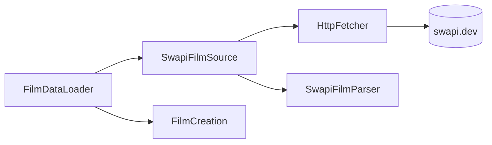
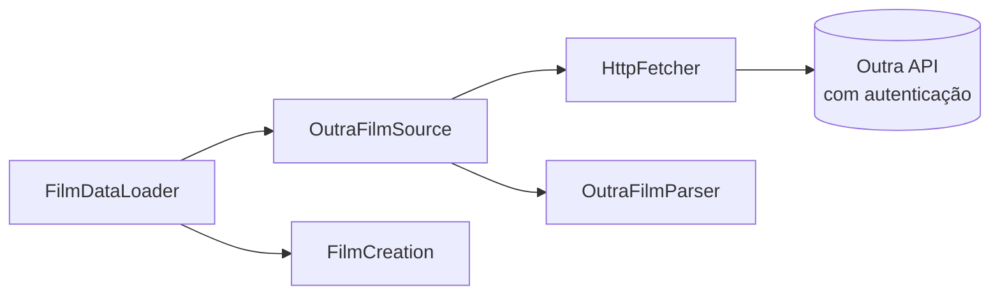
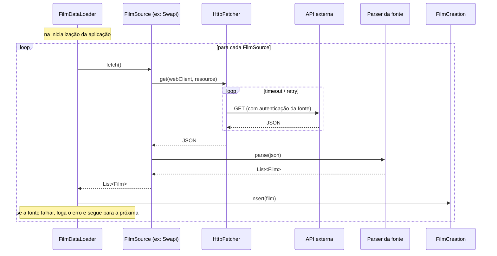

# desafio-swapi
Desenvolver api usando dados de SWAPI

## Cargas de dados (fontes)

Ao subir a aplicação, os filmes são carregados a partir de uma ou mais **fontes** (`FilmSource`).
Cada fonte conhece a sua API: host, autenticação e formato do JSON. Hoje existe a `SwapiFilmSource`,
mas é possível ter várias cargas: o `FilmDataLoader` percorre todas as fontes registradas e, se uma
falhar, registra o erro e segue para a próxima.

#### Visão geral


#### Fonte SWAPI



#### Outra fonte (exemplo)



#### Sequência da carga



### O que a fonte define

Cada fonte devolve `List<Film>` já preenchida com o que a sua API oferece:

- `title`, `releaseDate` e, se existirem, `synopsis`, `runtimeMinutes` e `director`;
- `franchise` (`Franchise(slug, name)`): a franquia do filme, como `star-wars` / "Star Wars". O `slug` vai na URL, então só aceita minúsculas, números e hífens;
- `label`: rótulo opcional usado no nome de apresentação (na SWAPI, "Episode IV");
- `extras`: `Map<String, String>` com dados específicos da fonte (na SWAPI, `openingCrawl` e `producer`);
- `source` e `externalId`: de onde o filme veio e o seu identificador lá;
- `id` (`Identifier`): definido pela própria fonte, no parser (na SWAPI, `star-wars-4` para o episódio IV).

Ao carregar, o `FilmDataLoader` não insere filme sem `id` nem com `id` já existente: ele é pulado, a carga segue e o problema aparece como `WARN` no log ao final da fonte.

## Endpoints

| Método | Path | Descrição |
|---|---|---|
| GET | `/films?page=&size=` | Lista paginada com `id`, `displayTitle` (ex.: "Episode IV - A New Hope") e `franchise` (o nome) |
| GET | `/films/{id}` | Detalhe do filme, incluindo `franchise` e `extras` |
| PATCH | `/films/{id}` | Altera `title`, `releaseDate`, `synopsis`, `runtimeMinutes` e `director` |
| GET | `/franchises` | Lista as franquias (`slug` e `name`) que têm filmes carregados |
| GET | `/franchises/{slug}/films?page=&size=` | Lista paginada dos filmes da franquia (mesmo formato do `/films`) |

O `displayTitle` é derivado: `label - title` quando há `label`, senão só o `title`.
A documentação interativa fica em `/swagger-ui.html`.

### Paginação

`GET /films` devolve uma página no formato:

```json
{
  "content": [
    { "id": "star-wars-1", "displayTitle": "Episode IV - A New Hope", "franchise": "Star Wars" },
    { "id": "star-wars-2", "displayTitle": "Episode V - The Empire Strikes Back", "franchise": "Star Wars" }
  ],
  "page": { "size": 2, "number": 0, "totalElements": 6, "totalPages": 3 }
}
```

- `page` começa em 0 e `size` é a quantidade de filmes por página. Um filme nunca aparece em mais de uma página.
- Uma página depois da última devolve `content` vazio.
- `page` negativo, `size` menor que 1 ou acima do máximo devolve 400.
- Os valores padrão ficam no `application.properties`:

```properties
pagination.default-page=0
pagination.default-size=2
pagination.max-size=100
```

### Franquias

`GET /franchises` devolve as franquias dos filmes carregados:

```json
[ { "slug": "star-wars", "name": "Star Wars" } ]
```

O `slug` só aparece em `/franchises`, porque é o que vai na URL. Nos filmes (`/films` e `/franchises/{slug}/films`) o campo `franchise` traz só o nome ("Star Wars").

`GET /franchises/star-wars/films` devolve a página de `FilmSummary` daquela franquia, com o mesmo formato e os mesmos parâmetros de paginação do `GET /films`. O slug não diferencia maiúsculas de minúsculas. Um slug que não existe devolve 404. A franquia de um filme não pode ser alterada pelo `PATCH`.

### Adicionando uma nova fonte

1. Criar o package `ingestion/<nome>/` com um `@ConfigurationProperties(prefix = "sources.<nome>")`.
2. Criar o parser do JSON daquela API, que devolve `List<Film>`.
3. Criar a classe `@Component` que implementa `FilmSource`, com o seu próprio `WebClient`
   (é nele que entra a autenticação) e usando o `HttpFetcher` para a chamada.
4. Configurar o host em `application.properties` (segredos via variável de ambiente).

O `HttpFetcher` é compartilhado e aplica timeout e retry, configurados em `http-client.*`.
