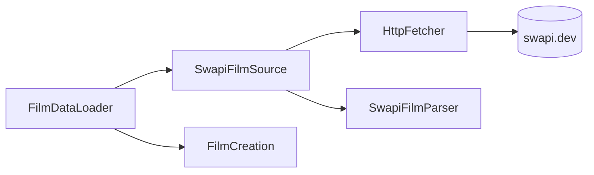
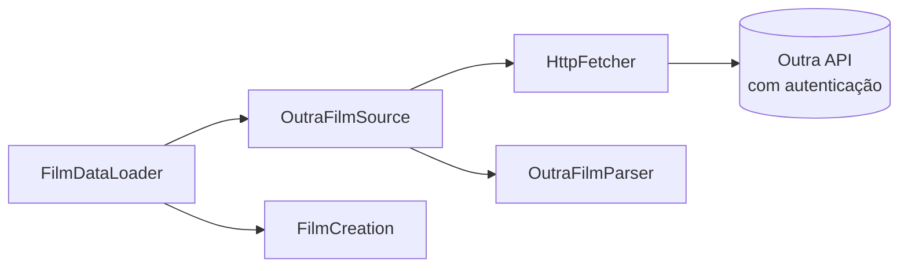
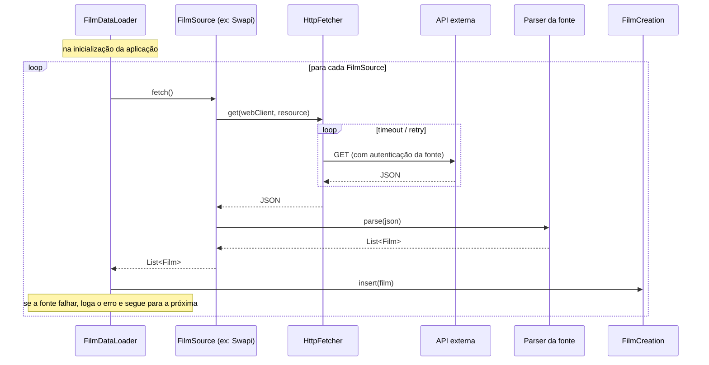

# desafio-swapi

API REST de filmes. Ao subir, ela carrega os filmes de uma ou mais **fontes** externas (hoje, a [SWAPI](https://swapi.dev), com os filmes de Star Wars) e os expõe com paginação, agrupamento por franquia e edição parcial.

A aplicação foi pensada para receber outras fontes além da SWAPI: cada fonte conhece a sua API, a sua autenticação e o formato do seu JSON. Veja [Como criar uma nova fonte](#como-criar-uma-nova-fonte).

**Stack:** Java 21, Spring Boot 4, MapStruct, Lombok, springdoc (Swagger) e Actuator.

## Como subir a aplicação

> A aplicação busca os filmes em `https://swapi.dev/api` ao iniciar, então precisa de acesso à internet. Se a SWAPI estiver fora do ar, a aplicação sobe mesmo assim, a lista de filmes fica vazia e o motivo aparece nos logs.

### Com Docker

Há dois Dockerfiles. Os dois geram a mesma aplicação, na porta 8080, rodando com um usuário sem root.

| Você tem | Use | O que faz |
|---|---|---|
| Só o Docker | `Dockerfile.build` | Constrói o jar dentro do Docker; o primeiro build é mais lento, porque baixa as dependências |
| Maven e JDK 21 | `Dockerfile` | Só empacota um jar já construído; o build da imagem é rápido |

**Só com Docker:**

```bash
docker build -f Dockerfile.build -t desafio-swapi .
docker run --rm -p 8080:8080 desafio-swapi
```

**Com Maven e JDK 21:**

```bash
mvn clean package -DskipTests
docker build -t desafio-swapi .
docker run --rm -p 8080:8080 desafio-swapi
```

No segundo caso o contexto do build contém só o jar (`Dockerfile.dockerignore`), então o `mvn package` precisa rodar antes do `docker build`.

### Sem Docker

```bash
mvn spring-boot:run
```

### Conferindo que subiu

```bash
curl localhost:8080/actuator/health/readiness   # {"status":"UP"} quando a carga dos filmes terminou
curl "localhost:8080/films"                     # primeira página de filmes
```

- Documentação interativa (Swagger): http://localhost:8080/swagger-ui.html
- `GET /actuator/health/readiness` só fica `UP` depois que a carga dos filmes termina; `GET /actuator/health/liveness` indica que o processo está de pé. Veja [No Kubernetes](#no-kubernetes).

### No Kubernetes

A aplicação só está pronta para receber requisições **depois que o `FilmDataLoader` termina a carga**. Enquanto ele roda, a porta HTTP já responde, mas o endpoint de readiness devolve 503; quem impede que o tráfego chegue ao pod nesse período é a `readinessProbe` do Kubernetes. Sem ela, o pod é considerado pronto assim que o contêiner inicia e recebe requisições com a lista ainda vazia.

| Endpoint | Durante a carga | Depois da carga | Uso |
|---|---|---|---|
| `/actuator/health/readiness` | 503 (`OUT_OF_SERVICE`) | 200 (`UP`) | `readinessProbe`: define se o pod recebe tráfego |
| `/actuator/health/liveness` | 200 (`UP`) | 200 (`UP`) | `livenessProbe`: define se o pod deve ser reiniciado |
| `/actuator/health` | 503 | 200 | Visão geral; **não use como probe** |

Exemplo de trecho de um Deployment:

```yaml
containers:
  - name: desafio-swapi
    image: desafio-swapi:latest
    ports:
      - containerPort: 8080
    env:
      - name: SPRING_PROFILES_ACTIVE      # logs em JSON para o Loki
        value: json
      - name: PAGINATION_DEFAULT_SIZE     # qualquer propriedade pode ser trocada por variável de ambiente
        value: "10"
    readinessProbe:
      httpGet: { path: /actuator/health/readiness, port: 8080 }
      periodSeconds: 5
    livenessProbe:
      httpGet: { path: /actuator/health/liveness, port: 8080 }
      periodSeconds: 10
```

Pontos de atenção:

- **Liveness separada da readiness.** O `/actuator/health` geral devolve 503 durante a carga; se ele fosse usado como liveness, o Kubernetes reiniciaria o pod em loop antes de a carga terminar.
- **Carga demorada não exige ajuste.** Se a readiness falhar por muito tempo, o pod só continua fora do balanceamento; ele não é reiniciado.
- **"Pronto" significa que a carga terminou, não que deu certo.** Se uma fonte estiver fora do ar na subida (por exemplo, a SWAPI), o erro vai para o log, o pod fica pronto e responde com lista vazia, e os dados só voltam com um reinício do pod. Essa é uma decisão de projeto; para exigir "pelo menos um filme carregado", seria preciso um indicador de saúde próprio no grupo `readiness`.
- **Memória.** A imagem define `JAVA_TOOL_OPTIONS=-XX:MaxRAMPercentage=75`, então a JVM usa 75% do limite de memória do contêiner. Para mudar, sobrescreva essa variável no `env`.
- **Só o tráfego via Service ou Ingress é bloqueado.** Quem chamar o IP do pod diretamente continua sendo atendido durante a carga.

### Configuração

Tudo fica em [application.properties](src/main/resources/application.properties), comentado. Qualquer propriedade pode ser trocada por variável de ambiente (`http-client.timeout` vira `HTTP_CLIENT_TIMEOUT`, e assim por diante):

```bash
docker run --rm -p 8080:8080 -e PAGINATION_DEFAULT_SIZE=5 -e HTTP_CLIENT_MAX_RETRIES=1 desafio-swapi
```

| Propriedade | Padrão | Para que serve |
|---|---|---|
| `pagination.default-page` | `0` | Página usada quando `page` não é informado |
| `pagination.default-size` | `2` | Filmes por página quando `size` não é informado |
| `pagination.max-size` | `100` | Maior `size` aceito; acima disso a API responde 400 |
| `http-client.timeout` | `5s` | Tempo máximo de espera por uma resposta de uma fonte |
| `http-client.max-retries` | `3` | Tentativas extras depois da primeira falha |
| `http-client.retry-backoff` | `2s` | Espera entre as tentativas |
| `sources.swapi.host` / `.resource` | `https://swapi.dev/api` / `/films` | Endereço da SWAPI |

### Testes

```bash
mvn test
```

## Endpoints

| Método | Path | Descrição |
|---|---|---|
| GET | `/films?page=&size=` | Lista paginada com `id`, `displayTitle` e `franchise` |
| GET | `/films/{id}` | Detalhe do filme, incluindo `extras` |
| PATCH | `/films/{id}` | Altera `title`, `releaseDate`, `synopsis`, `runtimeMinutes` e `director` |
| GET | `/franchises` | Lista as franquias (`slug` e `name`) que têm filmes carregados |
| GET | `/franchises/{slug}/films?page=&size=` | Lista paginada dos filmes da franquia |

### Listar filmes

```bash
curl "localhost:8080/films?page=0&size=2"
```

```json
{
  "content": [
    { "id": "star-wars-1", "displayTitle": "Episode I - The Phantom Menace", "franchise": "Star Wars" },
    { "id": "star-wars-2", "displayTitle": "Episode II - Attack of the Clones", "franchise": "Star Wars" }
  ],
  "page": { "size": 2, "number": 0, "totalElements": 6, "totalPages": 3 }
}
```

- `page` começa em 0, e `size` é a quantidade de filmes por página. Um filme nunca aparece em mais de uma página.
- Uma página depois da última devolve `content` vazio.
- `page` negativo, `size` menor que 1 ou acima do máximo devolve 400.
- O `displayTitle` é derivado: `label - title` quando o filme tem `label`, senão só o `title`.

### Detalhe de um filme

```bash
curl localhost:8080/films/star-wars-4
```

```json
{
  "id": "star-wars-4",
  "title": "A New Hope",
  "displayTitle": "Episode IV - A New Hope",
  "franchise": "Star Wars",
  "releaseDate": "1977-05-25",
  "synopsis": null,
  "runtimeMinutes": null,
  "director": "George Lucas",
  "extras": { "openingCrawl": "It is a period of civil war...", "producer": "Gary Kurtz, Rick McCallum" },
  "source": "swapi",
  "version": "1"
}
```

`synopsis` e `runtimeMinutes` são `null` porque a SWAPI não os fornece; `extras` guarda o que é específico da fonte. Um id que não existe devolve 404:

```json
{ "detail": "Film not found: nope", "instance": "/films/nope", "status": 404, "title": "Not Found" }
```

### Editar parcialmente um filme

```bash
curl -X PATCH localhost:8080/films/star-wars-4 \
  -H 'Content-Type: application/json' \
  -d '{"runtimeMinutes": 121}'
```

Só os campos enviados mudam. A `version` é incrementada **somente** quando algo realmente mudou, então repetir a mesma requisição não altera a versão. `id`, `franchise`, `extras` e `source` não podem ser alterados.

### Franquias

```bash
curl localhost:8080/franchises
```

```json
[ { "slug": "star-wars", "name": "Star Wars" } ]
```

`GET /franchises/star-wars/films` devolve a página de filmes daquela franquia, com o mesmo formato e os mesmos parâmetros de paginação do `GET /films`. O slug não diferencia maiúsculas de minúsculas, e um slug que não existe devolve 404. O `slug` só aparece em `/franchises`, porque é o que vai na URL; nos filmes, `franchise` traz só o nome.

## Estrutura da aplicação

```
com.akr.films
├── controller   FilmController, FranchiseController, paginação, filtro de log
├── service      FilmService, FranchiseService
├── repository   interfaces por capacidade (FilmCreation, FilmFindable, FilmUpdatable, FranchiseFindable)
│   └── memory   InMemoryFilmRepository
├── ingestion    FilmSource, FilmDataLoader, HttpFetcher
│   └── swapi    SwapiFilmSource, SwapiFilmParser, SwapiProperties
├── mapper       MapStruct (entidade <-> respostas)
├── domain       Film, Franchise, Identifier, páginas, respostas
└── exception    exceções e tratamento de erros (ProblemDetail)
```

Os dados ficam em memória: são recarregados a cada inicialização.

### Como a carga funciona

Ao subir, o `FilmDataLoader` percorre todas as fontes (`FilmSource`) registradas e grava os filmes no repositório. Se uma fonte falhar, o erro é registrado e a carga segue para a próxima.


Para a SWAPI, a fonte usa o `HttpFetcher` (que aplica timeout e retry) para buscar o JSON e o `SwapiFilmParser` para convertê-lo em filmes:



Uma fonte nova segue o mesmo desenho, com a sua própria API, autenticação e parser:





### O que a fonte define

Cada fonte devolve `List<Film>` já preenchida com o que a sua API oferece:

- `id` (`Identifier`): **obrigatório e único**, definido pela própria fonte no parser. Na SWAPI é `star-wars-<episódio>` (por exemplo, `star-wars-4`).
- `title`, `releaseDate` e, se existirem, `synopsis`, `runtimeMinutes` e `director`.
- `franchise` (`Franchise(slug, name)`): a franquia, como `star-wars` / "Star Wars". O `slug` vai na URL, então só aceita minúsculas, números e hífens.
- `label`: rótulo opcional usado no nome de apresentação (na SWAPI, "Episode IV").
- `extras`: `Map<String, String>` com dados específicos da fonte (na SWAPI, `openingCrawl` e `producer`).
- `source` e `externalId`: de onde o filme veio e o seu identificador lá.

O `FilmDataLoader` não insere filme sem `id` nem com `id` já existente: o filme é pulado, a carga segue e o problema aparece como `WARN` no log ao final da fonte.

### Como criar uma nova fonte

Não é preciso registrar nada: o Spring encontra os componentes e o `FilmDataLoader` recebe todas as fontes. Exemplo para uma API fictícia:

1. **Propriedades**, em `ingestion/<nome>/`. O record é detectado sozinho:

   ```java
   @ConfigurationProperties(prefix = "sources.fastfurious")
   public record FastFuriousProperties(String host, String resource, String apiKey) {}
   ```

   ```properties
   sources.fastfurious.host=https://api.exemplo.com
   sources.fastfurious.resource=/movies
   sources.fastfurious.api-key=${FF_API_KEY}
   ```

2. **Parser** do JSON daquela API, que devolve `List<Film>` com o `id`, a `franchise` e o restante preenchidos.

3. **A fonte**, uma classe `@Component` que implementa `FilmSource`. É no `WebClient` dela que entra a autenticação:

   ```java
   @Component
   public class FastFuriousFilmSource implements FilmSource {

       private final WebClient webClient;
       private final FastFuriousProperties properties;
       private final HttpFetcher httpFetcher;
       private final FastFuriousFilmParser parser;

       public FastFuriousFilmSource(FastFuriousProperties properties, HttpFetcher httpFetcher,
               FastFuriousFilmParser parser) {
           this.properties = properties;
           this.httpFetcher = httpFetcher;
           this.parser = parser;
           this.webClient = WebClient.builder()
                   .baseUrl(properties.host())
                   .defaultHeader(HttpHeaders.AUTHORIZATION, "Bearer " + properties.apiKey())
                   .build();
       }

       @Override
       public List<Film> fetch() {
           String json = httpFetcher.get(webClient, properties.resource()).block();
           return parser.parse(json);
       }
   }
   ```

Os segredos devem vir de variável de ambiente, não do arquivo. O `HttpFetcher` é compartilhado e aplica timeout e retry, configurados em `http-client.*`. A `SwapiFilmSource` e o `SwapiFilmParser` são a referência completa.

## Logs (Grafana/Loki)

Por padrão o console mostra texto legível. Com o perfil `json`, cada log vira **uma linha JSON**, pronta para o Loki e consultável no Grafana:

```bash
mvn spring-boot:run -Dspring-boot.run.arguments=--spring.profiles.active=json
# ou, no Docker:
docker run --rm -p 8080:8080 -e SPRING_PROFILES_ACTIVE=json desafio-swapi
```

Cada linha traz `@timestamp`, `level`, `message`, `logger_name`, `app` e:

- **`event`**: nome estável do que aconteceu (`http_request`, `film_updated`, `film_not_found`, `request_rejected`, `source_import_summary`, `film_skipped`, `http_retry`, `http_failed`, ...). É o campo para contar, agrupar e alertar.
- **Contexto do evento**, como `filmId`, `source`, `slug`, `page`, `size`, `version`, `status`, `durationMs`, `imported`, `total`.
- **`requestId`**: presente em todas as linhas de uma requisição. Vem do header `X-Request-Id` (ou é gerado) e é devolvido no mesmo header da resposta. As chamadas ao `/actuator` não são logadas.

Exemplos de consulta no Grafana (LogQL):

```logql
{app="desafio"} | json | event="http_request" | status >= 500
{app="desafio"} | json | event="film_not_found"
{app="desafio"} | json | requestId="req-42"
{app="desafio"} | json | event="source_import_summary" | imported < total
```

Use poucos rótulos no Loki (por exemplo `app` e `level`) e deixe `filmId` e `requestId` no corpo do JSON: são valores de cardinalidade alta.
