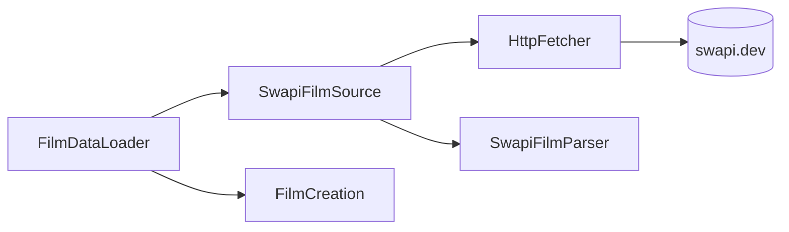
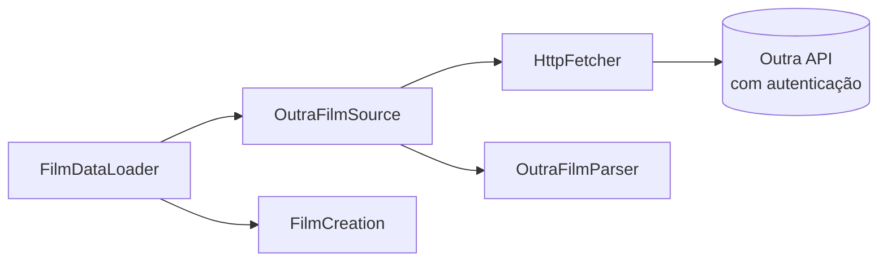
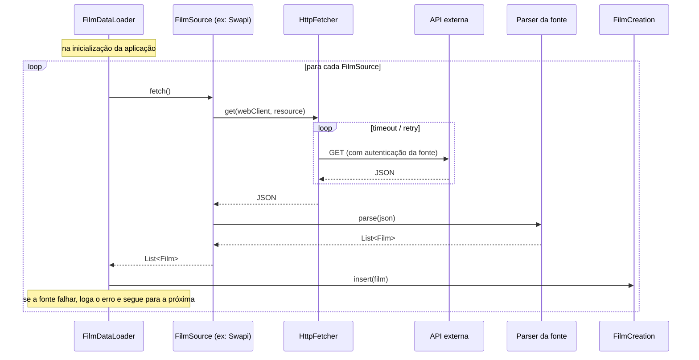

# desafio-swapi
Desenvolver api usando dados de SWAPI

## Cargas de dados (fontes)

Ao subir a aplicação, os filmes são carregados a partir de uma ou mais **fontes** (`FilmSource`).
Cada fonte conhece a sua API: host, autenticação e formato do JSON. Hoje existe a `SwapiFilmSource`,
mas é possível ter várias cargas: o `FilmDataLoader` percorre todas as fontes registradas e, se uma
falhar, registra o erro e segue para a próxima.

#### Visão geral

#### Fonte SWAPI

#### Outra fonte (exemplo)

#### Sequência da carga

### Adicionando uma nova fonte

1. Criar o package `source/<nome>/` com um `@ConfigurationProperties(prefix = "sources.<nome>")`.
2. Criar o parser do JSON daquela API, que devolve `List<Film>`.
3. Criar a classe `@Component` que implementa `FilmSource`, com o seu próprio `WebClient`
   (é nele que entra a autenticação) e usando o `HttpFetcher` para a chamada.
4. Configurar o host em `application.properties` (segredos via variável de ambiente).

O `HttpFetcher` é compartilhado e aplica timeout e retry, configurados em `http-client.*`.
